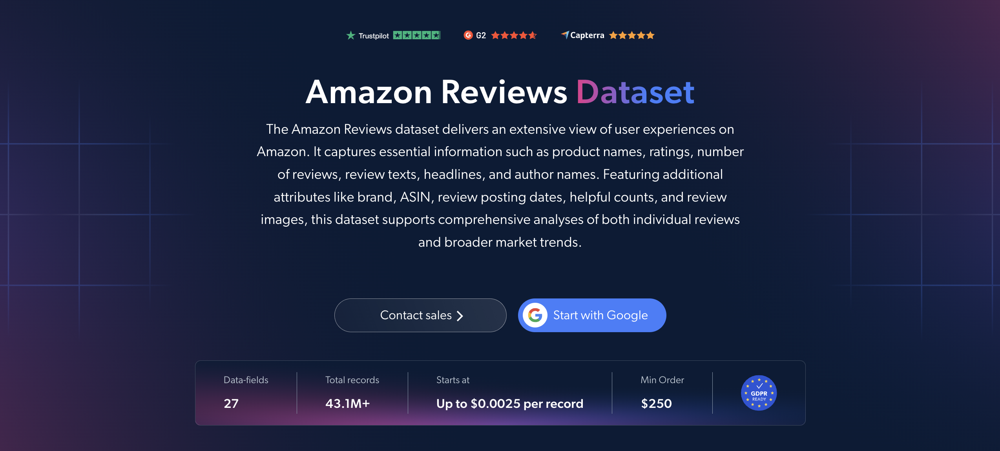

# Amazon-Reviews-dataset-samples

<h2>A sample dataset of 1000 Amazon reviews</h2>

<a href="https://brightdata.com/products/datasets/amazon/reviews">
   
</a>

An Amazon reviews dataset sample of 1000 product reviews. Dataset was extracted using the <b>Bright Data API</b>.

<h2>Some of the data points that are included in the dataset:</h2>

* ```url```: URL of the review on Amazon
* ```review_id```: Unique identifier for each review
* ```asin```: Amazon Standard Identification Number of the product
* ```product_name```: Name of the product
* ```brand```: Brand of the product
* ```categories```: Categories of the product
* ```department```: Department of the product
* ```product_rating```: Average rating of the product
* ```product_rating_count```: Total number of ratings for the product
* ```product_rating_object```: Breakdown of the product's ratings by stars
* ```rating```: Rating given by the reviewer
* ```review_header```: Title of the review
* ```review_text```: Text content of the review
* ```review_posted_date```: Date the review was posted
* ```review_country```: Country associated with the review
* ```author_name```: Name of the reviewer
* ```badge```: Badge or recognition of the reviewer
* ```is_verified```: Whether the review is from a verified purchase
* ```is_amazon_vine```: Whether the review is part of the Amazon Vine program
* ```helpful_count```: Number of users who found the review helpful
* ```variant_name```: Product variant that was reviewed, such as size or color
* ```review_images```: Images attached to the review
* ```videos```: Videos attached to the review

And a lot more.

This is a sample subset which is derived from the "Amazon Reviews (public data)"
dataset which includes more than <b>43,100,000 reviews</b>.

Available dataset file formats: <b>JSON, NDJSON, JSON Lines, CSV, or Parquet. Optionally, files can be compressed to .gz</b>.

Dataset delivery type options: <b>Email, API download, Webhook, Amazon S3, Google Cloud storage, Google Cloud PubSub, Microsoft Azure, Snowflake, SFTP</b>.

Update frequency: <b>Once, Daily, Weekly, Monthly, Quarterly, Biannual, or Custom basis</b>.

Data enrichment available as an addition to the data points extracted: <b>Based on request.</b>

<b>[Get the full Amazon Reviews dataset](https://brightdata.com/products/datasets/amazon/reviews)</b>.

<a href="https://brightdata.com/products/datasets/amazon/reviews">
</a>

<h2>What are the Amazon Reviews datasets use cases?</h2>

<h3>1. Product performance analysis</h3>
Businesses use Amazon reviews datasets to assess how products perform with customers. By analyzing review text, ratings and helpful votes, companies uncover satisfaction levels, common issues and highly praised features that inform product improvements and marketing messages.

<h3>2. Customer behavior insights</h3>
Brands analyze review countries, reviewed variants and verified purchases to understand customer preferences and purchasing patterns. These insights support more personalized marketing, better product recommendations and smarter decisions about which variants to promote.

<h3>3. Review authenticity checks</h3>
Analysts separate verified-purchase and Amazon Vine reviews from the rest and weigh them by helpful votes. This gives a more reliable read on product quality and helps filter out low-signal feedback before it skews analysis.

<h2>Free access to web scraping tools and datasets for academic researchers and NGOs</h2>

The Bright Initiative offers access to Bright Data's <b>[Web Scraper APIs](https://brightdata.com/products/web-scraper)</b> and <b>[ready-to-use datasets](https://brightdata.com/products/datasets)</b> to leading academic faculties and researchers, NGOs and NPOs promoting various environmental and social causes. You can submit an application <b>[here](https://brightinitiative.com)</b>.
